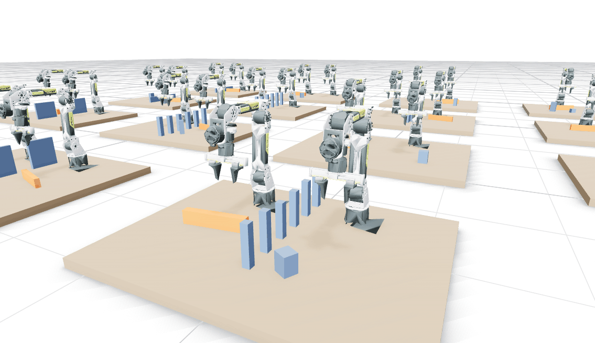
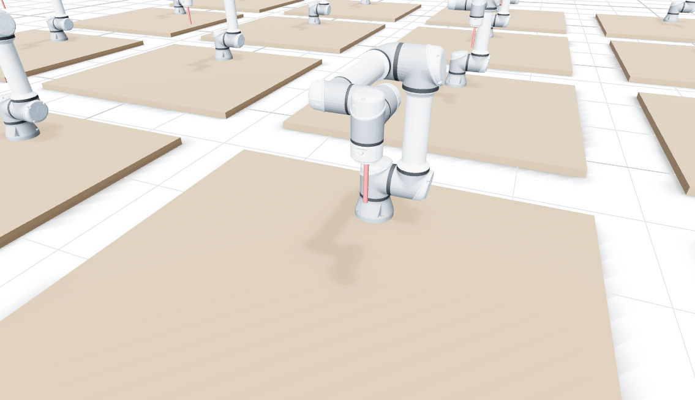

<h1 align="center">batchplan</h1>

<p align="center">
  <em>Batched motion planning for robotics.</em>
</p>



<p align="center">
  <a href="#quick-start"><b>Quick start</b></a> ·
  <a href="docs/README.md">Docs</a> ·
  <a href="docs/api.md">API</a> ·
  <a href="docs/benchmarks.md">Benchmarks</a> ·
  <a href="#examples">Examples</a> ·
  <a href="demos/">Demos</a> ·
  <a href="docs/architecture.md">How it works</a>
</p>

<p align="center">
  <a href="https://github.com/natsuku-lab/batchplan/actions/workflows/ci.yml"></a>
</p>

---

**batchplan is a Rust library for batched, collision-aware robot motion planning.** Solve IK, find paths, and generate trajectories within robot limits across many scenes in one call. Planning runs on the CPU, with optional [wgpu](https://wgpu.rs) acceleration for IK and trajectory optimization.

Use it standalone, through its [ROS 2 integration](https://github.com/natsuku-lab/batchplan-ros), or to generate [LeRobot training datasets](docs/training-data.md).

- **Plan:** batched IK, RRT-Connect on SIMD collision checks, and B-spline paths, optionally optimized with L-BFGS, timed optimally within velocity, acceleration, jerk and hand speed limits. Paths can keep a cup upright or a tray level between two hands, follow straight lines, pick and place, join without stopping, and start while the robot moves.
- **Live motion:** follow a trajectory as the world changes, replan or stop in time, and servo the hand toward a moving target.
- **Robots:** URDF, MJCF or OpenUSD, including mimic, ball and floating joints and closed loops, or several robots assembled into one. Collision spheres are fitted automatically. IK solves every hand at once, and one arm can hold still while another moves.
- **Worlds:** boxes, spheres, cylinders, capsules and distance grids from meshes, point clouds or fused depth images, with the links allowed to touch them.
- **Data:** reaches with recoveries, pick-and-place episodes and two-arm handovers, with grippers and task strings, plus perturbed start states for reinforcement learning. Export as LeRobot v3.0 datasets or NumPy arrays, and replay in MuJoCo with camera videos (`scripts/replay_mujoco.py`).
- **Embeddable:** CPU-only builds, threads you own, time budgets, allocation-free sampling and typed errors, for use inside a robot's control process.

## Install

```bash
cargo add batchplan                        # --features lerobot,usd for the optional features below
pip install "git+https://github.com/natsuku-lab/batchplan#subdirectory=python"   # from Python (a Rust toolchain builds it)
```

From Python, the `batchplan` package binds the same calls, with NumPy arrays in and out ([Python](docs/python.md)).

| Cargo feature | Default | Adds |
|---|---|---|
| `gpu` | on | GPU devices through wgpu. Without it, batchplan is CPU-only and has no GPU dependencies. |
| `lerobot` | off | LeRobot v3.0 export (Arrow, Parquet). |
| `usd` | off | Robots and scenes from OpenUSD. |

batchplan builds on stable Rust 1.90 or later (1.96 with `usd`), with no build flags to set: its collision checks use the widest SIMD instructions the CPU has, chosen when the program runs (SSE2 up to AVX-512 on x86-64, NEON on ARM).



<p align="center"><em>Twenty UR5e arms drawing with a pen, in <a href="docs/planning.md#moving-the-hand-along-a-path">straight lines</a> planned in one call, the pen <a href="docs/perception.md#allowed-contacts">allowed to touch</a> the table and kept under 15 cm/s (<a href="demos/README.md#moving-the-hand-in-straight-lines">demo</a>).</em></p>

## Quick start

Each snippet below is a whole program. Its paths point at test robots in this repository's `assets/`, so to run one as it is, clone the repository, save the snippet as `examples/first.rs` and run `cargo run --release --example first`. In your own project, point it at your robot's file.

### Plan a batch of motions

```rust,no_run
use batchplan::glam::{Quat, Vec3};
use batchplan::{
    Device, Error, Obstacle, PlanOptions, PlanProblem, Pose, Robot, RobotOptions, Trajectory,
    World,
};

fn main() -> Result<(), Error> {
    // Any URDF, MJCF or USD robot. Collision spheres are fitted when it loads.
    let robot = Robot::load(
        "assets/ur5e/ur_description/urdf/ur5e.urdf",
        &RobotOptions::default(),
    )?;
    // The CPU is fastest for a few problems; Device::gpu(&robot) pays off from a few hundred.
    let device = Device::cpu(&robot)?;

    // Scenes are uploaded once. Problems name their scene by index.
    let table = Obstacle::cuboid(Vec3::new(0.0, 0.0, -0.02), Vec3::new(1.0, 1.0, 0.02));
    let worlds = device.upload(&[World::new(vec![table])])?;

    // A collision-free motion to each of a batch of gripper poses, in one call: IK from the start
    // finds where each ends, the nearest collision-free solution.
    let down = Quat::from_rotation_x(std::f32::consts::PI);
    let problems: Vec<PlanProblem> = [Vec3::new(0.4, 0.2, 0.3), Vec3::new(0.3, -0.3, 0.4)]
        .into_iter()
        .map(|position| PlanProblem::new(0, robot.default_q(), Pose::new(position, down)))
        .collect();
    let plans = batchplan::plan(&device, &worlds, &problems, &PlanOptions::default())?;

    // Time each path within the robot's velocity, acceleration and jerk limits.
    for s in plans.solved() {
        let trajectory = Trajectory::try_new(&robot, s.solution, 1.0)?;
        let samples = trajectory.sample(100.0)?; // 100 Hz, for a controller
        println!(
            "motion {}: {:.2} s, {} samples",
            s.index,
            trajectory.duration(),
            samples.len()
        );
    }
    Ok(())
}
```

### Pick up a box

```rust,no_run
use batchplan::glam::{Quat, Vec3};
use batchplan::{
    CollisionModel, Device, Error, GraspOptions, Obstacle, Pick, Pose, Robot, RobotOptions,
    TaskOptions, World,
};

fn main() -> Result<(), Error> {
    // A Panda with its fingers held open. IK targets `ee_link`, between the fingertips.
    let options = RobotOptions {
        ee_links: vec!["ee_link".into()],
        lock_joints: [("panda_finger_joint1", 0.04), ("panda_finger_joint2", 0.04)]
            .map(|(joint, open)| (joint.to_string(), open))
            .into(),
        collision_model: Some(CollisionModel::load("assets/franka/panda_collision.json")?),
        ..Default::default()
    };
    let robot = Robot::load("assets/franka/franka_panda.urdf", &options)?;
    let device = Device::cpu(&robot)?;

    // A box on a table, in three scenes: on the left, ahead, on the right.
    let table = Obstacle::cuboid(Vec3::new(0.4, 0.0, -0.02), Vec3::new(0.7, 0.8, 0.02));
    let block = Obstacle::cuboid(Vec3::ZERO, Vec3::new(0.02, 0.03, 0.03));
    let worlds: Vec<World> = [0.25, 0.0, -0.25]
        .map(|y| block.placed(Pose::new(Vec3::new(0.45, y, 0.03), Quat::IDENTITY)))
        .map(|placed| World::new(vec![table.clone(), placed]))
        .into();
    let worlds = device.upload(&worlds)?;

    // Pick it up in every scene at once, by any grasp that fits the fingers, off the table.
    let grasps = batchplan::grasps(&block, &GraspOptions::default())?;
    let picks: Vec<Pick> = (0..3)
        .map(|world| Pick {
            support: vec![0],
            ..Pick::new(world, robot.default_q(), 1, grasps.clone())
        })
        .collect();
    let picked = batchplan::pick(&device, &worlds, &picks, &TaskOptions::default())?;
    for (world, outcome) in picked.outcomes.iter().enumerate() {
        match outcome {
            // Every grasp that works, quickest first: move in, close the gripper, lift.
            Ok(plans) => println!("scene {world}: picked up in {:.1} s", plans[0].duration()),
            Err(why) => println!("scene {world}: {why}"),
        }
    }
    Ok(())
}
```

`batchplan::place` sets it down again, from where the pick ends ([Picking up and setting down](docs/planning.md#picking-up-and-setting-down)).

### Make a training dataset

With `--features lerobot`:

```rust,no_run
use batchplan::datagen::DemoOptions;
use batchplan::glam::{Quat, Vec3};
use batchplan::lerobot::ExportOptions;
use batchplan::{Device, Error, IkProblem, Pose, Robot, RobotOptions, World, datagen, lerobot};

fn main() -> Result<(), Error> {
    let robot = Robot::load(
        "assets/ur5e/ur_description/urdf/ur5e.urdf",
        &RobotOptions::default(),
    )?;
    let device = Device::cpu(&robot)?;
    let worlds = device.upload(&[World::default()])?;

    // Reaches to 64 goals, plus recoveries from states perturbed along them.
    let down = Quat::from_rotation_x(std::f32::consts::PI);
    let goals: Vec<IkProblem> = (0..64)
        .map(|i| {
            Vec3::new(
                0.3 + 0.03 * (i % 8) as f32,
                -0.25 + 0.06 * (i / 8) as f32,
                0.3,
            )
        })
        .map(|position| IkProblem::new(0, Pose::new(position, down)))
        .collect();
    let demos = datagen::demonstrations(&device, &worlds, &goals, &DemoOptions::default())?;
    println!("{} demonstrations", demos.len());

    // A LeRobot v3.0 dataset, ready for `lerobot-train`.
    lerobot::export(
        "data/reaches",
        &robot,
        &worlds,
        &demos,
        &ExportOptions::default(),
    )
}
```

From here, the [guides](#where-to-find-things) go further: planning around [what a depth camera sees](docs/perception.md#depth-images), moving the hand [in straight lines](docs/planning.md#moving-the-hand-along-a-path), [two arms](docs/robots.md#several-arms-several-hands) at once. The [examples](#examples) and [demos](demos/) run them on many scenes.

## Where to find things

| | |
|---|---|
| [AGENTS.md](AGENTS.md) | For coding agents using batchplan: conventions, the lifecycle, which call fits a task, qualifying a robot, reading results, and diagnosing a failed request in order. |
| [API](docs/api.md) | Every type and function, by task, with the guide for each. |
| [Planning](docs/planning.md) | IK, searching and smoothing paths, keeping clear of obstacles, optional trajectory optimization, goals a turn away, moving the hand in straight lines, picking up and setting down, joining motions, timing, replanning mid-motion, live motion and servoing, and the options worth knowing. |
| [Robots](docs/robots.md) | URDF, MJCF and OpenUSD; joint types, mimic joints and closed loops; several arms as one robot; collision spheres; holding objects; checking against meshes. |
| [Worlds and perception](docs/perception.md) | Obstacles, allowed contacts, scenes, distance grids, depth images, masking the robot, and fused occupancy maps. |
| [Training data](docs/training-data.md) | Reaches with recoveries, pick-and-place, handovers between two arms, reset states, and exporting to NumPy or LeRobot. |
| [Devices](docs/devices.md) | GPU or CPU, which GPUs work, and running inside a robot's control process. |
| [Benchmarks](docs/benchmarks.md) | Against VAMP, OMPL, RoboPlan and MoveIt 2 on one robot model, RoboKit in its own benchmark, GPU against CPU, spheres against meshes, and how to reproduce them. |
| [Demos](demos/) | Handovers, pick-and-place, depth cameras and replanning, live in Rerun, and GIFs of tasks and tool paths. |

## How it compares

Every planner below plans on one robot model, VAMP's spherized Panda, and one independent checker judges every output. The problems are the 262 final ones of MotionBenchMaker and MπNets, run with 5 seeds × 3 rounds on one AMD Ryzen AI Max+ 395, with 16 cores per planner. [Setup, matched settings, one core and per set](docs/benchmarks.md#against-other-planners) · [Run it yourself](docs/benchmarks.md#reproducing)

**Paths:**

| Planner | Valid | Clear on the meshes | Time per query (median) | Valid paths/s | Path length |
|---|---|---|---|---|---|
| **batchplan** | **91.2%** | **86.6%** | **0.11 ms** | **42,842** | **1** |
| [VAMP](https://github.com/KavrakiLab/vamp) 0.6.4¹ | 87.6% | 67.3% | 0.16 ms | 31,517 | 1.11× |
| [RoboPlan](https://github.com/open-planning/roboplan) 0.7 | 84.7% | 68.9% | 75 ms | 72 | 1.44× |
| [OMPL](https://ompl.kavrakilab.org) 1.7¹ | 64.9% | 56.9% | 1.1 ms | 17 | 1.33× |
| [MoveIt 2](https://moveit.ai) Jazzy | 62.0% | 55.1% | 40 ms | 34 | 1.40× |

¹ On the scenes with cylinders as capsules, which VAMP and OMPL take. batchplan on those: 91.2% valid, 86.7% clear, 0.11 ms, 42,773 valid paths/s.

**Trajectories**, within the Panda's velocity, acceleration and jerk limits:

| Planner | Valid | Time per query (median) | Valid trajectories/s | Duration |
|---|---|---|---|---|
| **batchplan** | **91.2%** | **0.52 ms** | **17,677** | **1** |
| RoboPlan, Linear Blend | 84.0% | 82 ms | 69 | 1.17× |
| RoboPlan, Adaptive | 81.1% | 86 ms | 65 | 1.11× |
| RoboPlan, Cubic | 75.9% | 84 ms | 62 | 1.11× |
| RoboPlan, Hermite | 56.2% | 78 ms | 47 | 1.13× |
| MoveIt 2, TOTG | 2.5% | 49 ms | 1 | 1.07ײ |
| MoveIt 2, Ruckig | 2.5% | 52 ms | 1 | 1.03ײ |

<details>
<summary>Reading these numbers</summary>

Lengths and durations are relative to batchplan's, on the problems both solve validly. ² Over the 26 and 22 problems MoveIt 2 solves validly. 63% and 58% of its trajectories stay within 10% of the limits, and those take 14% and 15% longer than batchplan's.

- 23 of the 262 problems start or end in collision, so no planner can pass 91.2%. batchplan solves all 3,585 of the other queries, and every path and trajectory it returns is valid.
- Per query, batchplan takes 17% less time than VAMP on 16 cores, and the two tie on one core. With matched settings (edges checked as finely, batchplan without its clearance, VAMP stopped at 10,000 samples), VAMP's 16 workers return more valid paths per second (61,501 against 51,759), and RoboPlan solves 89.1% against batchplan's 88.4%. [All of it](docs/benchmarks.md#reading-the-results).
- On cuRobo's own spheres, batchplan solved 98.9% of the box-only problems against cuRobo's 85.2% ([the earlier comparison](docs/benchmarks.md#the-earlier-comparison), with cuRobo on a T4 and batchplan on an M4 Pro).

</details>

### Batches and the GPU

Planning runs on CPU threads on either device; IK and trajectory optimization also run on the GPU. Each call here solves IK and plans a batch of tabletop grasps, end to end, in solved problems per second:

| Problems per call | M4 Pro GPU | M4 Pro CPU (14 cores) | Radeon 8060S GPU | Ryzen AI Max+ 395 CPU (16 cores) |
|---|---|---|---|---|
| 1 | 83 | **2,583** | 292 | **3,145** |
| 8 | 1,263 | **4,602** | 1,959 | **6,617** |
| 64 | 3,796 | **7,140** | 8,289 | **11,755** |
| 512 | **14,676** | 10,135 | **33,196** | 14,588 |
| 4,096 | **20,622** | 10,441 | **37,740** | 14,422 |

A GPU call costs 3.4 ms on the Radeon (12 ms on the M4 Pro), so one problem at a time runs 11–31 times faster on the CPU; from a few hundred problems per call the GPU overtakes it, and at 4,096 it solves 2–2.6 times as many.

### When another library fits better

- **VAMP**, from Python, or for its asymptotically optimal planners (AORRTC, FCIT*) and roadmaps (PRM) on the same fast checks.
- **cuRobo**, for model-predictive control and NVIDIA's perception stack (nvblox), if you have an NVIDIA GPU.
- **MoveIt 2**, for ROS 2: perception, controllers, grasping and the rest of a robot's stack around the planner.
- **OMPL**, for its range of planners, such as asymptotically optimal and kinodynamic ones.

## Working on batchplan

| | |
|---|---|
| [Contributing](CONTRIBUTING.md) | Building and testing, the style guide the code follows, and what a change needs. |
| [How it works](docs/architecture.md) | How the code fits together: a map of the modules, devices, planning, searches, collision, the GPU, tool paths, joins and tasks, timing and training data. |
| [Verification](docs/verification.md) | Running the tests, and what each one pins down. |
| [CLAUDE.md](CLAUDE.md) | The design rules, invariants and working rules, for people and coding agents. |

## Examples

| Command | What it does |
|---|---|
| `scripts/fetch_rebot.sh && cargo run --release --example handover` | Two reBot B601 arms hand blocks to each other in 512 scenes, three in four divided down the middle: the bimanual benchmark. `--features lerobot` and `-- 16 --lerobot data/handover` write a LeRobot dataset, and `scripts/replay_mujoco.py data/handover data/handover_video` adds three camera videos. |
| `cargo run --release --example bench -- 512` | IK and planning for 512 cluttered tabletop scenes, GPU against CPU. |
| `cargo run --release --example datagen -- data/demo 512 20` | Reaches and recoveries in 512 scenes, as `.npy` arrays at 20 fps. |
| `cargo run --release --features lerobot --example datagen -- --pick-place --lerobot data/pick 512 20` | Pick-and-place episodes as a LeRobot dataset. |
| `cargo run --release --example tasks` | Picks and places on 64 random tabletops: how many get through, where the rest stop, and how long a call takes. |
| `cargo run --release --example tool_paths` | Straight moves and pours of the Panda's hand, one at a time and 64 at once. |
| `cargo run --release --example depth` | Builds a distance grid from a rendered depth image and plans around it. |
| `cargo run --release --example control_loop -- 10` | A planner thread feeding a 50 Hz control loop. |
| `scripts/fetch_benchmark.sh && cargo run --release --example benchmark` | The 2,600 MotionBenchMaker and MπNets problems, on every device. |

[`demos/`](demos/) shows them live in [Rerun](https://rerun.io): two reBot arms handing blocks over, Panda pick-and-place around obstacles, whole tasks picked out of clutter, planning around what depth cameras see, and replanning mid-motion. Its [GIFs](demos/README.md#gifs) show this page's handovers, Pandas carrying boxes over and around walls, posts and arches, and UR5e arms drawing shapes with a pen in straight lines.

### With ROS 2

[batchplan-ros](https://github.com/natsuku-lab/batchplan-ros) is a ROS 2 node (Lyrical and Jazzy) that speaks MoveIt's messages without needing MoveIt: a `MoveGroup` action and an IK service, with the scene in each request. Several goals in one request are planned in one batched call, and the shortest path wins. It comes with a browser demo of a simulated Panda (`pixi run demo`, on Linux or macOS) and an optional MoveIt planner plugin, through which batchplan plans the stock Panda demo's requests in 4–5 ms, against OMPL's 14–15 ms.

## Limitations

- **Spheres.** Planning sees the robot as spheres. `MeshModel` checks finished plans against its meshes on the CPU, as a filter, and `Robot::qualify` measures how far the spheres reach past each link.
- **Payloads.** A held object collides as part of the robot, but has no mass: timing keeps the joints' limits whatever the robot carries.
- **Joints.** Each closed loop must have exactly one actuated joint. Ball and floating joints are expanded into Euler angles, which lose a direction of motion where the middle angle reaches ±90°.
- **Timing.** Jerk is kept within its limit by smoothing the time-optimal profile, slowing it where the smoothed map overshoots and stretching what remains, which costs time where a path turns sharply at speed: a wide blend through a sharp turn gains little over stopping ([joining motions](docs/benchmarks.md#joining-motions)). `Trajectory::check` samples each trajectory at a fixed density, so it can miss a short jerk overshoot between its samples.
- **Small batches on a GPU.** A GPU call costs milliseconds however small the batch (4 on a Radeon 8060S), so below a few hundred problems per call the CPU is faster ([Batches and the GPU](#batches-and-the-gpu)). Planning itself runs on CPU threads on either device.
- **Generated pick-and-place and handovers.** `datagen`'s episodes grasp upright boxes from above and have no recoveries; `pick` and `place` themselves take other shapes and grasps. Camera videos come from replaying the episodes in MuJoCo, kinematically: no physics checks the grasps.
- **Maturity.** batchplan is before 1.0, and its interface may change between minor versions ([changelog](CHANGELOG.md)). It is tested on AMD (Vulkan) and Apple (Metal) GPUs; on NVIDIA, only earlier versions ran (on a T4).

## License

Licensed under either of [Apache License, Version 2.0](LICENSE-APACHE) or [MIT license](LICENSE-MIT), at your option.

The test robots under `assets/` keep their own licences, listed with their sources and changes in [assets/README.md](assets/README.md):

- The Franka Panda is from franka_ros and NVlabs/curobo (Apache-2.0). Its collision spheres in `assets/franka/panda_collision.json` are converted from cuRobo's `franka.yml` (Apache-2.0, © NVIDIA).
- The UR5e is from Universal Robots' ROS 2 description (BSD-3-Clause).
- The Robotiq 2F-85 is from PickNik's ros2_robotiq_gripper (BSD-3-Clause).
- The SO-101 is from TheRobotStudio's SO-ARM100 (Apache-2.0).

The reBot B601 arms that `examples/handover/` uses are not in the repository: `scripts/fetch_rebot.sh` downloads them from Seeed Studio's [reBot-DevArm](https://github.com/Seeed-Projects/reBot-DevArm) at a pinned commit (CERN-OHL-W-2.0).
