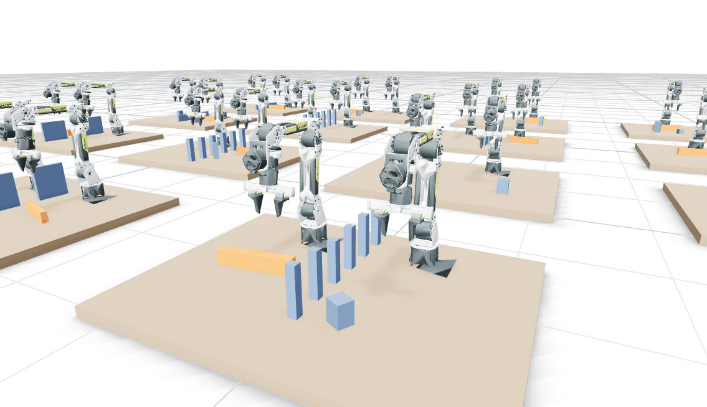
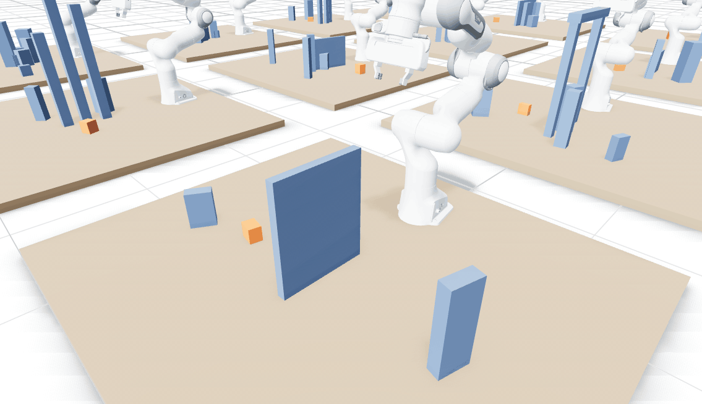
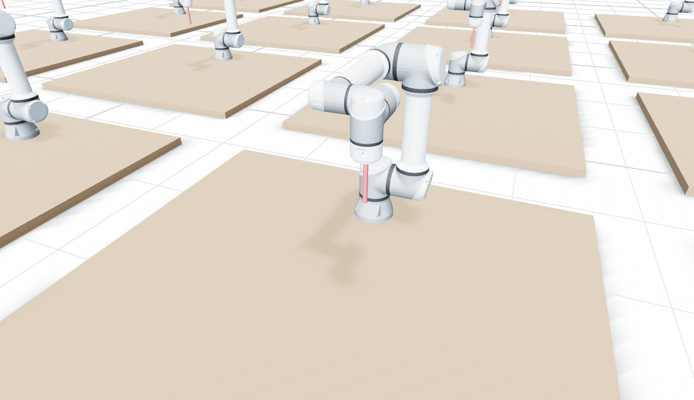

# Demos

batchplan planning live in [Rerun](https://rerun.io), and the GIFs of the README and below. This is a crate of its own, so the library never depends on a viewer.

## In Rerun

| Demo | What it shows |
|---|---|
| `handover` | Two reBot B601 arms hand blocks to each other in 16 scenes at once, those of [`examples/handover/`](../examples/handover/). One `datagen::handover` call plans every episode. |
| `pick` | Pick-and-place on the Franka Panda in 16 scenes, each with a wall, posts, an arch or a cluster of boxes between the box and its place; in 14 of them it blocks the straight carry. |
| `tasks` | Whole tasks: in 16 scenes the Panda picks a box out of clutter (`batchplan::pick`, by any grasp `batchplan::grasps` proposes) and sets it down at a free spot (`batchplan::place`). Two calls plan every scene; a lid over one box and a crate over one spot show what a failed task reports. |
| `perception` | Three simulated depth cameras, the robot masked out of their images, fused into a distance grid that the robot then plans around. |
| `replan` | Robots replanning mid-motion from their current velocity and acceleration when boxes appear in their path, or first stopping on their path. |

Run them from this directory. Each opens the viewer, which needs the `rerun` command at the Rust crate's version (0.38.1):

```bash
uv venv .venv --python 3.12 && uv pip install --python .venv/bin/python rerun-sdk==0.38.1
../scripts/fetch_rebot.sh ../data/rebot                   # the reBot arms (CERN-OHL-W-2.0)
../scripts/fetch_panda_meshes.sh ../data/franka_visual    # the Panda's visual meshes (Apache-2.0); without them, its collision meshes
PATH="$PWD/.venv/bin:$PATH" cargo run --release --bin handover    # [scenes] [--gpu | --cpu]
PATH="$PWD/.venv/bin:$PATH" cargo run --release --bin pick
PATH="$PWD/.venv/bin:$PATH" cargo run --release --bin tasks
PATH="$PWD/.venv/bin:$PATH" cargo run --release --bin perception
PATH="$PWD/.venv/bin:$PATH" cargo run --release --bin replan
cargo run --release --bin handover -- 16 --save handover.rrd      # a recording instead; open it with `rerun handover.rrd`
```

## GIFs

### Handovers



Two reBot B601 arms at each of 20 tables hand a block over, from the episodes of [`examples/handover/`](../examples/handover/): the giver picks it up (`batchplan::pick`), both arms move to meet at once, and the taker sets it down (`batchplan::place`) while the giver goes home (`Place::idle`).

### Picking up and setting down



A Panda at each of 20 tables picks a box up and sets it down on the other side of a wall, a row of posts, an arch or a cluster of boxes, so the carry has to go over or around it: the scenes of the `pick` demo, planned with `datagen::pick_and_place`. In front, the box goes over a 37 cm wall.

### Moving the hand in straight lines



A UR5e at each of 20 tables draws a shape with a pen, in straight lines through its corners (`batchplan::follow`), every arm in one call: `cargo run --release --bin drawing -- <out_dir>` plans them and writes the motions. The pen may touch the table (`World::touch`; without it every pen stops just above it), and goes no faster than 15 cm/s (`Trajectory::with_hand_speed`).

