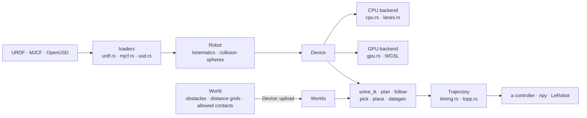
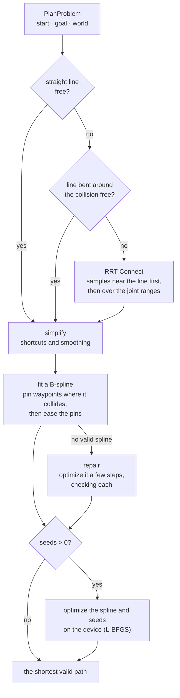
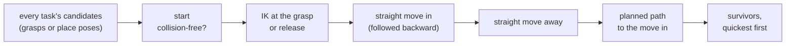
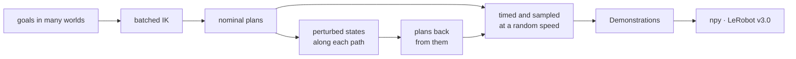

# Architecture

How batchplan's code is organised, and why. [`CLAUDE.md`](../CLAUDE.md) holds the rules for changing it; each module's doc comment holds its details, and its constants say why they have the values they do.

## The shape of it

A robot and its worlds go onto a device once. Every algorithm then takes the device, the worlds and a batch of problems, and returns each problem with its answer.

**`Device` is the only way to run a batch.** It holds the robot and one of two backends, CPU or GPU, behind the crate-private `Backend` trait. It checks every batch (array shapes, world indices, and that the worlds were uploaded to it) before either backend sees it, so bad input is an error on both.

**Both backends compute the same numbers.** The GPU kernels and `cpu.rs` implement the same math function by function, and parity tests hold them together. Searches, which are sequential, run on CPU threads on either device, with the same checks. So results depend on neither the batch nor the device.

**Algorithms are plain functions.** `solve_ik`, `plan`, `follow`, `pick`, `place` and `datagen` take a device, its worlds and problems, and exchange the shared types. Each owns its seeding, validation and choice of answer. There are no planner plugins and no runtime configuration.

| Modules | What they own |
|---|---|
| `robot.rs`, `description.rs`, `urdf.rs`, `mjcf.rs`, `usd.rs`, `loops.rs`, `spheres.rs` | Loading a robot: each format into one description, closed loops into mimic joints, the kinematic tree, fitted collision spheres and the self-collision pairs worth checking. |
| `world.rs`, `sdf.rs` | Obstacles, their distances and allowed contacts; distance grids from meshes, points and depth images; fused occupancy maps. |
| `device.rs`, `cpu.rs`, `lanes.rs`, `gpu.rs`, `*.wgsl` | Running batches: validation, the two backends, SIMD collision checks on the CPU. |
| `ik.rs` | Batched IK: damped least squares from many seeds, pushed away from obstacles. |
| `trajopt.rs`, `rrt/`, `shortcut.rs`, `edges.rs`, `spline.rs` | Planning: searching, simplifying, fitting a B-spline, and optimizing it on the device; the protocol searches use to ask for edge checks. |
| `tool_path.rs` | Moving a hand in straight lines through poses (`follow`). |
| `task.rs` | Picking up and setting down in one call (`pick`, `place`), and proposing grasps. |
| `timing.rs`, `topp.rs` | Timing a path within the joints' limits (`Trajectory`), starts in motion and controlled stops. |
| `datagen.rs`, `npy.rs`, `lerobot.rs` | Demonstrations for training, and their export. |
| `meshes.rs` | Exact clearance against the robot's meshes, as a check after planning. |
| `types.rs`, `error.rs`, `rng.rs` | The shared types, typed errors, and the generator every algorithm seeds from. |

## Design rules

- **Batch-first.** Every call covers many items, and items name their world by index (`IkProblem::world`, `PlanProblem::world`), so one call spans many scenes.
- **Worlds live on the device.** `Device::upload` prepares worlds once (GPU buffers, CPU rotation matrices), and every algorithm takes them as `&Worlds`.
- **Results carry their problems.** `solved()` yields each problem with its solution; the world comes from the problem, never from its position in a list.
- **Seeds come from the problem.** Each problem's generator mixes the options' seed with the problem's own numbers (`Rng::for_problem`), so a problem draws alike in any batch, and both devices see bit-identical inputs.
- **Loaders stay thin.** A loader only translates a file into the internal description; kinematics, sphere fitting and self-collision analysis never see a format.
- **Errors are typed at the surface.** Public functions return `batchplan::Error`, whose kind a host matches on.

## Planning a path

`plan` runs each problem as one search on one CPU thread, from start to finish. Only optional trajectory optimization runs on the device, batched over every problem.

1. **Search** (`rrt::Connect`). RRT-Connect as VAMP runs it: Halton samples, dynamic domains, balanced trees and a k-d tree for nearest neighbours. Samples come first from a tube around the straight line, widening until it spans the joint ranges. The search keeps a clearance from obstacles for its first samples, then continues the same trees without it.
2. **Simplify** (`shortcut::Simplify`). VAMP's simplification: the straight line, then passes of greedy shortcuts and smoothing.
3. **Fit** (`trajopt::Fitting`). A cubic B-spline through the simplified path, its control points spread by arc length. Where it collides, the nearest waypoint is pinned; with every waypoint pinned, it traces the path exactly. Each pin is then eased into the widest blend that keeps the spline valid, as OpenRAVE's smoother removes a path's stops. Splines are checked keeping the shortcuts' clearance, then a 2 mm margin, so a curve cannot graze an obstacle between samples.
4. **Repair.** A problem searched but left without a valid spline has the spline optimized a few steps on its own thread, with idle threads helping, and takes the first step that checks valid.
5. **Optimize** (optional, `PlanOptions::seeds`). The searched spline and seeds straight to the goal, or bent through random points, are optimized together on the device and validated densely; the shortest valid path wins.

A goal on a joint whose range spans more than a turn is reached at whichever equivalent, a whole turn away, is nearest or free. Held joints (`PlanProblem::hold`) are never sampled away from their start, and every stage keeps them. A start in motion (`PlanProblem::start_motion`) pins the spline's first span to the current velocity and acceleration.

## Searches

Sampling-based planning is sequential and branchy, so searches run on CPU threads. A search (RRT-Connect, simplification, checking a spline, following a tool path) is a small state machine (`edges::Search`): it asks for an edge check, takes the answer and decides what to ask next. The SIMD lanes answer at once; a GPU device keeps a CPU copy of its worlds for them.

- **Edge checks** follow VAMP: eight states spread over the edge, each pass stepping back, stopping at the first collision. A link's spheres are placed only when its bounding sphere is near something, a sphere around each obstacle rules it out before the exact test, and distances are compared squared.
- **Scheduling.** Each thread takes the next search from a shared counter until none is left, as VAMP's batches do. A batch lasts as long as its longest search, often an unsolvable one that draws every sample, so threads with nothing left help searches that have checked many samples (`rrt/ahead.rs`): they replay the search's trees from its log and check the edges its next samples will ask about. The search takes an answer only for a query equal to its own bit for bit, so it grows the same trees as it would alone.
- **Memory.** A search allocates nothing per query: it writes each query into a buffer its thread lends it. It is also built on the thread that runs it (`edges::Deferred`), so the memory it grows belongs to that thread's allocator arena. Built on the caller, every thread of a batch waited on the caller's arena lock.

## Collision

The robot is a set of spheres; obstacles are boxes, spheres, cylinders, capsules or distance grids. A configuration's collision cost sums the squared penetration of every sphere into every obstacle, and of every sphere pair the self-collision model checks, within a margin.

- **Gating.** Each link has a bounding sphere around its spheres. An obstacle farther from it than the margin skips the link's spheres, and so does a link pair for self-collision. Distance grids are always checked: their interpolated distance can change faster than the distance itself. The gap stands in for their clearance, so clearances stay exact up to the margin.
- **Gradients** accumulate a wrench per link; one reverse pass from the leaves gives each joint its share.
- **Links no joint moves** (the base and what is fixed to it) are not checked against the world: their contact with the scene does not depend on the configuration, and a mounted robot's base rests on its table.
- **Allowed contacts.** A world's `touch` lists become one link bit set per obstacle at upload. Every check skips a (link, obstacle) pair in its set: on the CPU, in the SIMD lanes, on the GPU and in `MeshModel`. Names resolve against the uploading robot, so a link attached later (a held object) touches nothing in worlds uploaded before it.
- **SIMD on the CPU** (`lanes.rs`). Eight configurations per call in `f32x8` lanes: forward kinematics, then world and self clearance, at the widest SIMD level the CPU has, found at run time (SSE2 up to AVX-512, NEON). Code enters that level once per search, and everything between that choice and the vector operations is inlined, with no closures: a closure loses the level and runs about seven times slower. `cpu::collision` stays the scalar twin the lanes are tested against.

## The GPU

- **The twin.** `kernels.wgsl`, with the code written per robot, and `cpu.rs` implement the same functions: forward kinematics, the collision cost and its gradient, the IK step and the trajectory optimizer's passes. `cpu.rs` keeps index loops so the two read side by side, and `tests/gpu.rs` and `tests/device.rs` hold them together.
- **One source of truth for layouts.** Every struct the GPU reads is declared once in Rust with `shader_struct!`, and its WGSL is generated from that; shared constants are written into the shader from their Rust values. So host and shader cannot drift.
- **Kernels written per robot.** `robot_wgsl` writes the robot's forward kinematics, Jacobians and collision cost link by link, each link's frame and wrench in its own variable. Mesa's RADV driver moves any run-time-indexed private array over 256 bytes into scratch memory; per-link arrays cost 3–5 KB of it per invocation, and writing the code per robot made GPU planning 4.8× faster on a Radeon and 2.7× on an M4 Pro. Kernels are compiled per robot shape and cached.
- **Lanes for small batches.** For small batches, collision kernels give each configuration 8 invocations that split its sphere loops; each kernel is built for 1 lane and for 8.
- **Trajectory optimization** is L-BFGS with a parallel line search. Each round dispatches five passes: the collision cost of every path moved by each of four step sizes; a per-path pass that takes the cheapest; the collision gradient at every sample; the gradient per control point; and a per-path pass for the next direction. Work is split across submissions to stay under driver watchdogs.

## Moving the hand along a path

`follow` runs each tool path as a search. It splits the path into poses a step apart and solves each by damped least squares from the configuration before (the IK step without its push away from obstacles). Where the joints' straight motion between two configurations strays from the path at its middle, the step is halved; eight halvings without meeting the precision is a jump. A cubic B-spline then passes through the configurations, resting at both ends and stopping wherever it would stray from the path or pass a joint limit. The spline is checked densely, honouring allowed contacts, and a collision cuts the motion back to before the span where it may first collide.

## Picking up and setting down

`pick` and `place` turn every task's grasps or place poses into candidates, and run them through the same steps. Each step is one batch over the candidates that reached it, across every task.

- **What each step may touch.** Each step runs in the task's world with the contacts it allows: the fingers on the object for the grasp and the move in; the held object on its supports for the lift and the set-down; the fingers on the placed object for backing off.
- **Holding.** A held object is a link attached to the robot (`Robot::attach`), so a lift or carry runs on a device for the holding robot (`Device::with_robot`). Holders for one hand name the held link alike, so one upload per hand serves them all. Candidates are grouped by what they hold, and the groups run in parallel on the device's threads.
- **The release.** Where the hand lets go fixes where the object is, so a place solves IK for the robot alone, then checks each solution holding its object, nearest the candidate's rest first.
- **Other arms.** A pick or place moves its hand's joints alone. With `Place::idle`, the transit also takes the other arms to where they wait.
- **Why a candidate failed.** IK that finds nothing is solved once more without its push away from obstacles: a pose reached then collides, one not reached is out of reach. Every candidate's step and reason make up the task's `TaskFailure`.

## Timing

A `Trajectory` is the path plus a time map `s = σ(t)`, itself a uniform cubic B-spline. `Trajectory::try_new` keeps the faster of two timings: uniform (`σ = t / h`, exact along the whole curve) and time-optimal (TOPP-RA on the path parameter, smoothed, with caps lowered where the smoothed map overshoots a limit). A cap on the hand's speed becomes a speed limit on `s`, from the hand's rate along the path. A start in motion is timed from its current speed along the path. A controlled stop (`Trajectory::stop`) keeps the path from the moment it starts and brakes to rest along it as soon as an even deceleration within the limits allows.

## Perception

Distance grids are built by a CPU/GPU twin too (`sdf.rs` / `grids.wgsl`): voxels are classified from depth images or points, then given distances by an exact distance transform in integer arithmetic, so both devices build identical grids from the same occupancy. A robot mask makes the space the robot fills free, so a camera that sees the arm never makes it an obstacle to itself. Grids store at most the true signed distance, less half a voxel diagonal, so interpolating between voxels never overestimates a clearance.

## Training data

- **Reaches** (`datagen::demonstrations`): IK with many seeds, nominal plans, then recoveries planned from states perturbed along them.
- **Pick-and-place** (`datagen::pick_and_place`): a `pick` per task, then a `place` from its end, so everything the tasks check holds for the episodes. Tasks that fail are tried again with the hand or the object turned.
- **Handovers** (`datagen::handover`): the giver's `pick`, IK for both hands where they meet, one plan moving both arms there, straight moves for the taker to grasp and the giver to let go, then the taker's `place` while the giver goes home (`Place::idle`).
- **Reset states** (`datagen::reset_states`): samples of the episodes with joint noise, checked collision-free, to start reinforcement learning from.
- **Export.** `npy` writes one array per field. `lerobot` writes the v3.0 layout natively (Parquet through Arrow, rolling files, statistics aggregated as LeRobot does), with the state laid out arm by arm and the robot described for simulators that replay it.

## The robot model

`Robot::load` reads the description, closes any kinematic loops (each loop's passive joints become polynomial mimics of its one actuated joint, fitted to the loop's static equilibrium), expands ball, planar and floating joints into one-axis joints, numbers the actuated joints breadth first, and fits collision spheres (cuRobo's voxel method) unless a model is given. `Robot::assemble` does the same for several descriptions, their names prefixed. Continuous joints wrap every turn, so they are clamped and checked with `Robot::bounds` and `Robot::within`. `MeshModel` measures exact clearance against the robot's meshes on the CPU, as a check after planning, not part of either device.

## Demos and performance

`demos/` is a crate of its own (Rerun), so the library never depends on a viewer; CI lints it in its own job. Performance claims come from alternating runs of two builds on one machine; [Benchmarks](benchmarks.md#how-the-speed-came) lists what those runs found.
